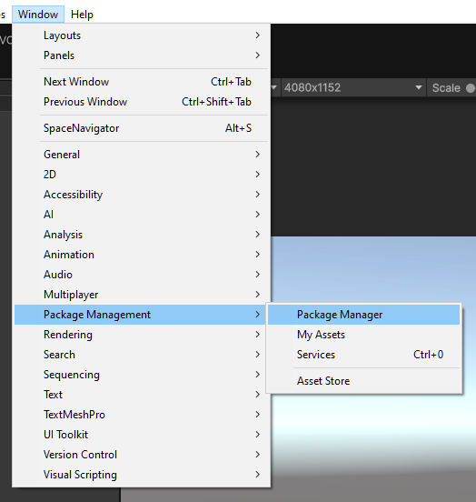
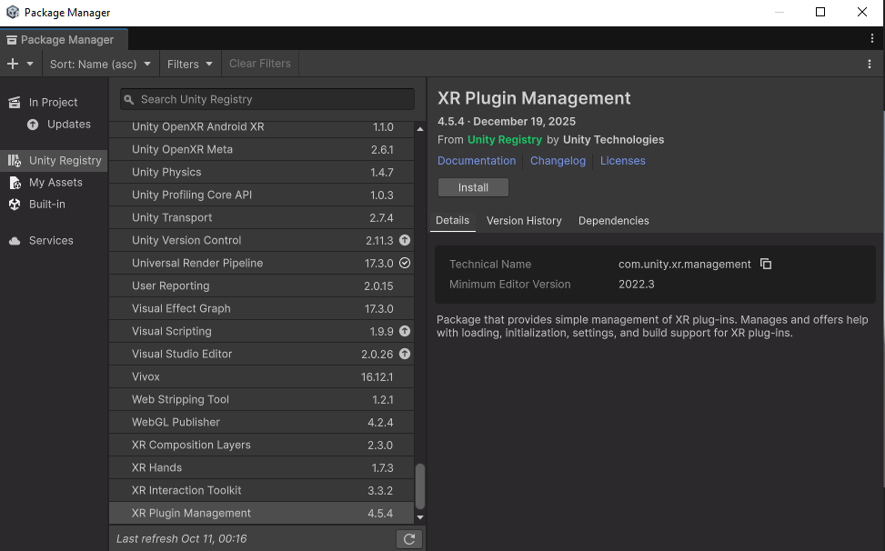
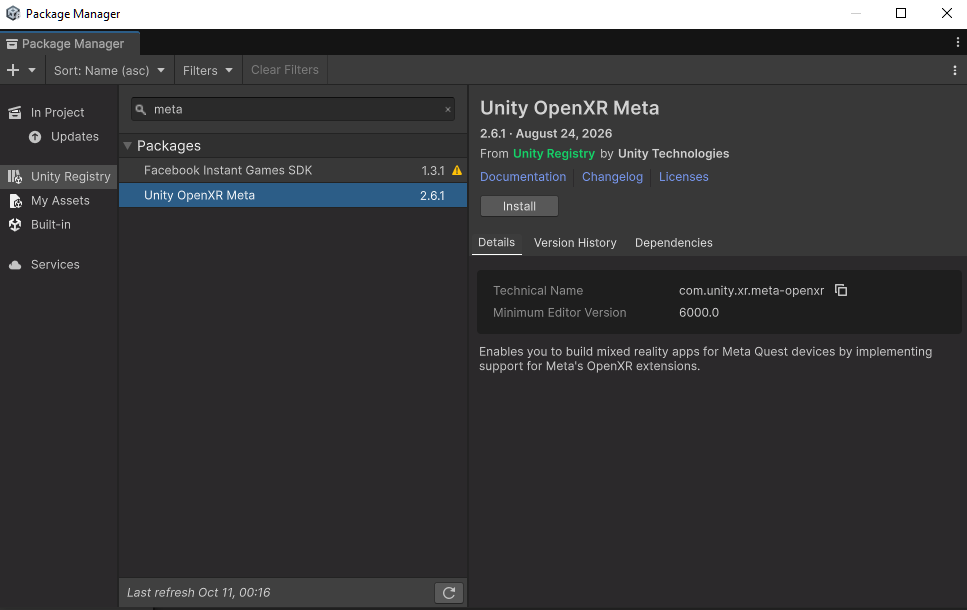
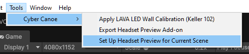
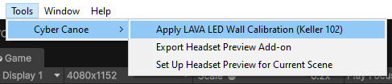
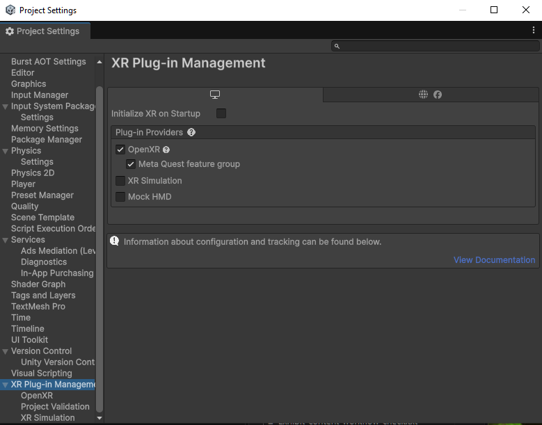

# Cyber Canoe Headset Preview

Preview your Cyber Canoe scene on a virtual LAVA LED wall using a PC-connected VR headset. The Keller 102 calibration matches the supplied classroom wall measurements.

This is an add-on for your existing class Unity project. It includes the headset preview scripts, screen shader, materials, setup tools, and calibration. Bring your own Cyber Canoe rig and scene content.

## Before installing

Use a Windows PC with a headset connected through Meta Quest Link or SteamVR, and a Cyber Canoe Unity project using Universal Render Pipeline (URP). Quest preview runs through the PC connection; this add-on does not configure standalone Android Quest builds.

The base [CyberCANOE development library](https://github.com/uhmlavalab/CyberCANOE) is provided by UH Manoa's LAVA lab. Start with your class's Cyber Canoe project and follow your instructor's library setup instructions before installing this add-on.

Your project must already provide `CC_CAMERA_SETUP`, `CC_CAMERAOFFSET`, `CC_SETTINGS`, and `CC_CANVAS_SETUP`.

The authoring project uses Unity **6000.3.9f1**. For Meta Quest PC preview, install XR Plugin Management and Unity OpenXR Meta if they are missing:

Click any screenshot to open the full-size original.

1. Open **Window > Package Management > Package Manager**.

   

2. Select **Unity Registry**, choose **XR Plugin Management** (`com.unity.xr.management`), and click **Install**. Wait for installation to finish.

   

3. Search for **meta**, select **Unity OpenXR Meta** (`com.unity.xr.meta-openxr`), and click **Install**. Wait for Unity to finish installing its dependencies.

   

Use Unity OpenXR Meta **2.6.1** and let Unity resolve compatible versions and finish installing dependencies. Meta brings in OpenXR, which brings in Input System. XR Management can update to satisfy these dependencies. Unity's [Meta package installation guide](https://docs.unity3d.com/Packages/com.unity.xr.meta-openxr@2.6/manual/install.html) describes automatic dependency installation.

Keep your class project's existing URP and Unity UI packages and settings. The installed versions here are URP 17.3.0, Unity UI 2.0.0, and Input System 1.18.0. [REQUIRED-PACKAGES.json](REQUIRED-PACKAGES.json) records reference versions, including dependencies; keep your project's existing `Packages/manifest.json`.

For a **SteamVR-only setup**, install XR Plugin Management and OpenXR Plugin (`com.unity.xr.openxr`); the Meta-specific extension package is optional.

Under **Edit > Project Settings > Player > Other Settings**, set **Active Input Handling** to **Input System Package (New)** or **Both**, and restart Unity if prompted.

## Install from this repository

1. Download this repository and extract it outside your Unity project, or clone it with GitHub Desktop.
2. Copy both `Assets/HeadsetPreview` and `Assets/HeadsetPreview.meta` into your class project's `Assets` folder. Include every `.meta` file and keep the folder structure intact.
3. Return to Unity and wait for importing and compilation to finish.

You can also import an exported `.unitypackage` through **Assets > Import Package > Custom Package**. Choose one installation method; both install the same add-on into `Assets/HeadsetPreview`.

## Set up the Keller 102 preview

1. Open your own Cyber Canoe scene containing `CC_HUB`, `CC_HEAD`, and its left/right cameras. Both cameras must use the same projection screen through `CC_CAMERAOFFSET`.
2. Choose **Tools > Cyber Canoe > Set Up Headset Preview for Current Scene**. This creates or reuses the headset simulator and configures the installed desktop OpenXR packages. It preserves your scene's existing screen and viewer calibration.

   

3. Choose **Tools > Cyber Canoe > Apply LAVA LED Wall Calibration (Keller 102)**. This applies the supplied wall and viewer measurements to the rig and headset room in the current scene. You can also use the matching calibration button in the simulator Inspector. The change supports Undo.

   

4. Save your scene.
5. Connect your headset through Meta Quest Link or SteamVR and select that application's OpenXR runtime.
6. Press **Play** and put on the headset. If the starting view needs resetting, select `CyberCanoe_HeadsetSimulator` and click **Recenter Viewer at Calibrated Position** in its Inspector.

Running setup again reuses the existing simulator. You do not need a separate Add Simulator step or a campus calibration preset. Keep global **Initialize XR on Startup** disabled; the simulator controls XR startup.

In **Edit > Project Settings > XR Plug-in Management**, select the **Windows, Mac, Linux** desktop tab. Check that **OpenXR** is enabled and **Initialize XR on Startup** is unchecked; the setup tool configures these two options. To match the pictured Quest configuration, also enable the **Meta Quest** feature group manually.

Your existing scene navigation still controls the Cyber Canoe content. Head movement changes your view of the virtual wall; this add-on does not add controller movement or pointer interaction.

## Present on the real wall

Stop Play mode, select `CyberCanoe_HeadsetSimulator`, uncheck the checkbox beside the **Cyber Canoe Headset Simulator** component title, and save your scene. Keep global **Initialize XR on Startup** disabled.

Leave the scripts and required packages installed so the scene continues to compile. To preview in the headset again, enable the component and its **Initialize XR** field, connect the headset, and press Play.

## Keller 102 measurements

| Setting | Value |
| --- | --- |
| Physical wall | 6.047 x 2.042 metres |
| Wall centre relative to CC_HUB | (0, 1.75, 2.282) |
| Head centre relative to CC_HUB | (0, 1.76, -2) |
| Viewing distance | 4.282 metres |
| Viewer vertical offset | 0.01 metre above wall centre |
| Eye separation | 0.061 metre |
| Stereo output | Normal side-by-side |
| Per-eye image | 4800 x 1620 pixels |

The calibration checks that the existing CC settings use 61 mm eye separation, normal eye order, and side-by-side output. If preview is slow, reduce both per-eye texture dimensions while preserving their aspect ratio. Keep the wall's physical size and viewing distance.

## Troubleshooting and sharing updates

- **Missing CC types:** import the class Cyber Canoe package first.
- **Missing XR or Input System types:** install the required Unity packages and wait for compilation.
- **No headset image:** check the PC connection, active OpenXR runtime, simulator component checkbox, and its Initialize XR field. Read the Unity Console and simulator Status.
- **Pink screen or room:** check that the class project's URP asset is active.

See the [full in-project guide](Assets/HeadsetPreview/README.txt) for rig requirements, calibration details, and troubleshooting.

To produce an installable package from a working Unity project, choose **Tools > Cyber Canoe > Export Headset Preview Add-on**. It writes `Artifacts/CyberCanoe-HeadsetPreview-Unity.zip` containing the `.unitypackage`, instructions, Unity version, and package reference list. Export again after changing the source files to include your updates.

For source updates, copy the latest `Assets/HeadsetPreview` and its metadata into this repository. Exclude generated `Assets/HeadsetPreview/ProjectSettings` and `ProjectSettings.meta`. Commit and push the updated files through GitHub Desktop.

The add-on export excludes your exhibit, scene content, class CC core scripts, and generated project XR settings. Check the final appearance on the physical wall before presenting in class.
